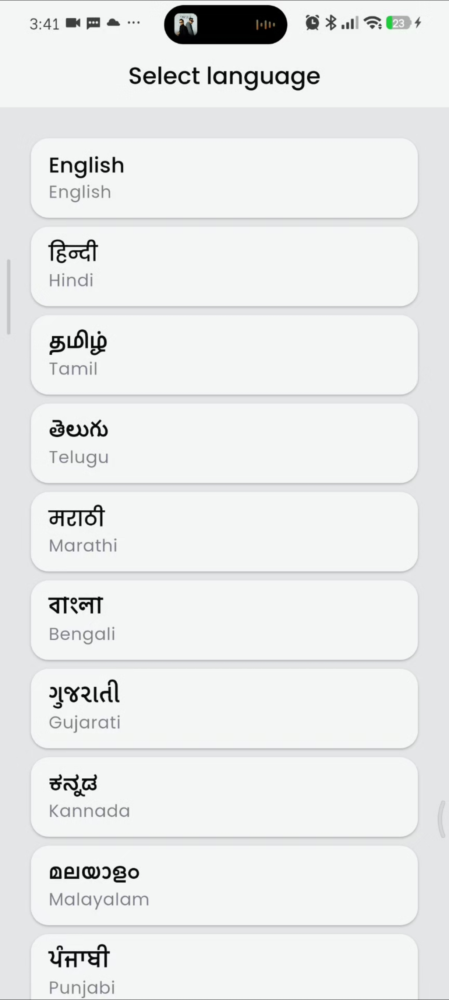
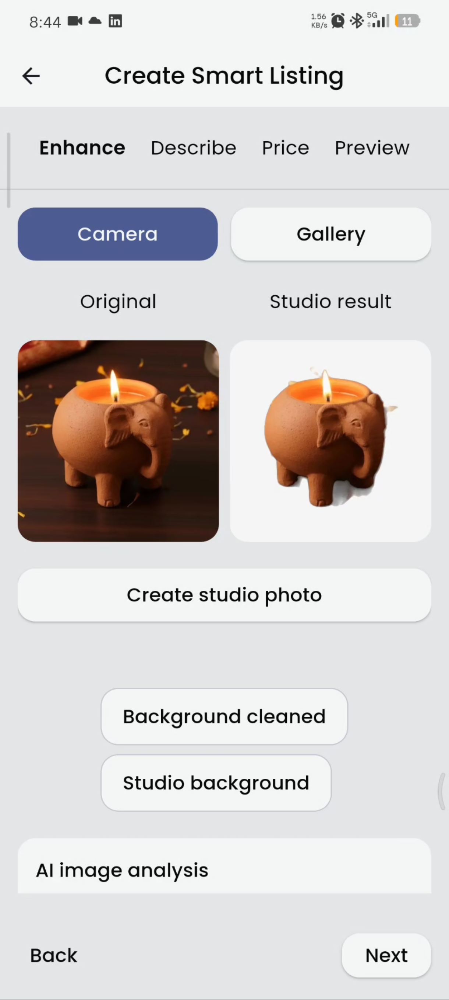
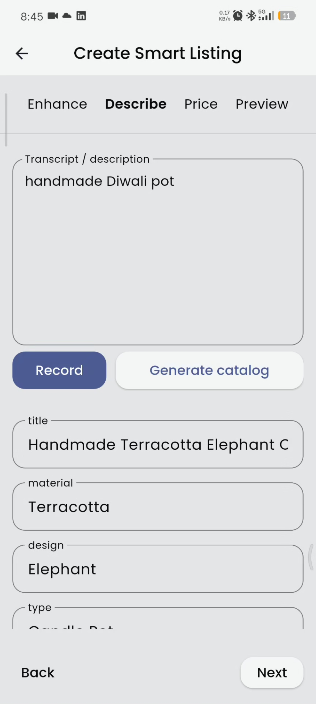
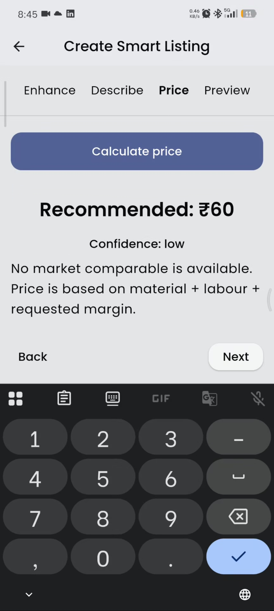
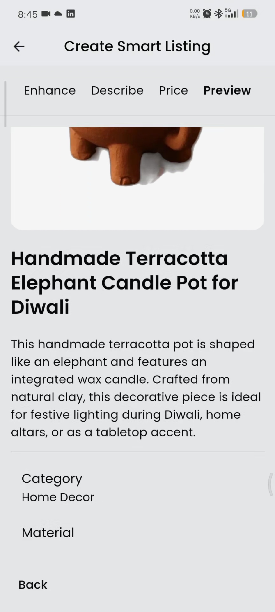

# Kala Setu

**Connecting India's traditional arts and crafts with the digital world.**

Kala Setu is a mobile application project developed as part of the Smart India Hackathon (SIH). The project explores how mobile technology and AI-powered features can help bridge the gap between traditional art forms, artisans, and modern digital experiences.

## 📱 About the Project

Traditional arts and crafts carry cultural value, stories, and knowledge that deserve to be preserved and shared. Kala Setu aims to use technology to make these art forms more accessible through a mobile-first experience.

This repository contains selected Flutter application source code and assets from the project.

## ✨ Key Features

- **Mobile Application UI:** User interfaces built with Flutter and Dart.
- **AI Assisted Product Enhancement:** Uses MediaPipe and Gemini Api
- **Voice-assisted product listing:** voice based description to smart Ai cataloging using Gemini.
- **Regional language support:** Uses BhashiniAi to provide 10 regional languages support.
- **AI-assisted smart pricing:** Learn from the market and suggest a competitive price.
- **Marketplace Connectivity:** connect Through ONDC to publish directly on Marketplaces like GEM
- **AI Integration:** Integration with AI APIs for the project's AI-powered functionality.
- **Product catalog management:** Supabase integration for authentication and database-related functionality.
- **UI/UX Design:** Interface design and implementation focused on usability and a consistent user experience.

## 🛠️ Tech Stack

| Technology | Purpose |
|---|---|
| Flutter | Cross-platform mobile app development |
| Dart | Application programming language |
| Supabase | Authentication and database integration |
| AI APIs | AI-powered application functionality |
| Figma | UI/UX design |

## 📂 Repository Structure

```text
kala-setu/
├── lib/          # Flutter application source code
├── assets/       # Application assets
├── LICENSE       # license
└── README.md     # Project documentation
```

This repository currently contains selected source folders rather than the complete Flutter project configuration.

## 🖼️ App Screenshots

Explore some of the key features of Kala Setu.

<div align="center">
  <table>
    <tr>
      <td align="center" width="50%">
        <a href="assets/images/Multilingual.jpeg">
          
        </a>
        <br>
        <strong>Multilingual Support</strong>
      </td>
      <td align="center" width="50%">
        <a href="assets/images/Image_Enhancement.jpeg">
          
        </a>
        <br>
        <strong>Image Enhancement</strong>
      </td>
    </tr>
    <tr>
      <td align="center" width="50%">
        <a href="assets/images/Generate_Catalog.jpeg">
          
        </a>
        <br>
        <strong>Generate Catalog</strong>
      </td>
      <td align="center" width="50%">
        <a href="assets/images/Market_Price.jpeg">
          
        </a>
        <br>
        <strong>Market Price</strong>
      </td>
    </tr>
    <tr>
      <td align="center" width="50%">
        <a href="assets/images/Cataloging.jpeg">
          
        </a>
        <br>
        <strong>Cataloging</strong>
      </td>
      <td width="50%"></td>
    </tr>
  </table>
</div>

## 🎬 App Demo

Watch the screen recording to explore Kala Setu's user interface, navigation, and implemented features.

**[▶️ Watch the Kala Setu App Demo](https://lnkd.in/p/gjARK7Sr)**

The demo showcases the application in action, providing a walkthrough of its implemented functionality.

## 👨‍💻 My Contributions

My work on Kala Setu included the following areas:

- Flutter application development using Dart.
- UI/UX design and interface implementation.
- Integration of AI APIs.
- Supabase authentication and database integration.

## 🚀 Getting Started

The current repository does not include the complete Flutter project configuration, so it may not run independently as cloned.

To run the complete application, you would need the corresponding Flutter project files, including `pubspec.yaml`, platform configuration, and any required environment variables.

For Flutter development information, visit the [official Flutter documentation](https://docs.flutter.dev/).

## 🔐 Configuration & Security

Any required API credentials or environment variables should be configured locally. Sensitive credentials must not be committed to version control.

## 🎯 Project Purpose

Kala Setu represents my experience working on a Flutter application involving UI/UX design, backend integration, and AI-powered functionality. It is part of my ongoing journey in building practical, user-focused mobile applications.

## 📬 Contact

**Flutter Developer | UI/UX Designer**
*from ideas -> Product*

- LinkedIn: [My LinkedIn Profile](www.linkedin.com/in/shlok1402)
- GitHub: [My GitHub Profile](https://github.com/shl00k)

For collaboration or freelance opportunities, feel free to connect with me on LinkedIn.
